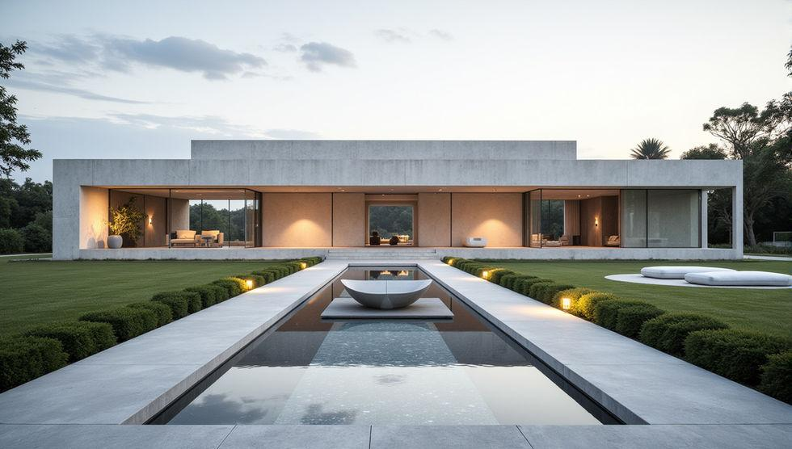

# Casa de Campo — Landing page imobiliária

Projeto pessoal de desenvolvimento web: uma landing page de alto padrão para a venda de uma casa de campo contemporânea, com animação cinematográfica controlada pela rolagem, galeria de ambientes e formulário de contato.

> Projeto de portfólio. O imóvel, as metragens e as imagens são ilustrativos.



## Destaques

- **Hero com animação por rolagem** — sequência de 110 quadros desenhada em `<canvas>`. A posição acompanha a rolagem com suavização e mistura dois quadros vizinhos, então o movimento continua fluido mesmo com a roda do mouse. Os quadros são pré-carregados do mais espaçado ao mais denso.
- **Galeria de ambientes** — transição em cortina (`clip-path`), avanço automático, pausa ao passar o mouse e visualização ampliada (lightbox) com navegação pelo teclado.
- **Números animados** — contadores de área, dormitórios e vagas disparados ao entrar na tela.
- **Navegação lateral** — trilho de progresso que indica a seção atual.
- **Formulário de contato** — validação acessível, envio por `POST` JSON para um endpoint configurável ou, sem endpoint, por `mailto:`. Atalho para WhatsApp.
- **Acessibilidade** — link "pular para o conteúdo", foco visível, `aria-*` nos controles e respeito a `prefers-reduced-motion`.
- **Responsivo** — menu móvel e layout fluido com `clamp()`.

## Tecnologias

- HTML, CSS e JavaScript
- React 18 (carregado via CDN pelo `support.js`)
- Google Fonts: Manrope, Jost e IBM Plex Mono

Sem etapa de build: o site é estático e abre a partir do `index.html`.

## Estrutura

```
.
├── index.html            # página única: template + lógica do componente
├── support.js            # runtime que interpreta o template e monta o React
├── assets/
│   ├── hero-frames/      # f001.jpg … f110.jpg — quadros da animação do hero
│   └── images/           # fotos da galeria e das seções
│       ├── fachada-principal.jpg
│       ├── fachada-posterior.jpg
│       ├── living-integrado.jpg
│       ├── cozinha.jpg
│       ├── sala-de-estar.jpg
│       └── vista-lateral.jpg
├── robots.txt
├── sitemap.xml
├── .env.example
└── LICENSE
```

## Como executar

O site carrega imagens por caminho relativo, então use um servidor local em vez de abrir o arquivo direto:

```bash
npx serve .
```

ou

```bash
python -m http.server 8000
```

Depois acesse `http://localhost:3000` (serve) ou `http://localhost:8000` (Python).

## Configuração

Os dados ficam no início do script em `index.html`:

- `PROPERTY.specs` — metragens e cômodos exibidos nos contadores.
- `PROPERTY.gallery` — título, texto, imagem e texto alternativo de cada foto.
- `CONFIG` — nome, e-mail, telefone, Instagram e mensagem padrão do WhatsApp.

Propriedades do componente (`data-props` no `<script data-dc-script>`):

| Propriedade        | Descrição                                                           |
|--------------------|---------------------------------------------------------------------|
| `whatsappNumber`   | Número em formato internacional, só dígitos (ex.: `5511999999999`). |
| `formEndpoint`     | URL HTTPS que recebe o formulário via `POST` JSON. Vazio = `mailto:`. |
| `showPendingNotes` | Mostra notas de pendência na página de privacidade.                 |

## Rotas

| Página                  | Rota            |
|-------------------------|-----------------|
| Início                  | `#/`            |
| Seções da página        | `#/casa` · `#/fotos` · `#/contato` |
| Política de privacidade | `#/privacidade` |

## Publicação

Por ser estático, pode ser hospedado no GitHub Pages, Netlify, Vercel ou Cloudflare Pages. No GitHub Pages: **Settings → Pages → Deploy from a branch**, branch `main`, pasta `/ (root)`. Ajuste o domínio em `robots.txt` e `sitemap.xml`.

## Autor

**Yuri Navas** — [metodonavas1@gmail.com](mailto:metodonavas1@gmail.com)

## Licença

Código sob a licença [MIT](LICENSE). As imagens são ilustrativas e não estão cobertas pela licença.
